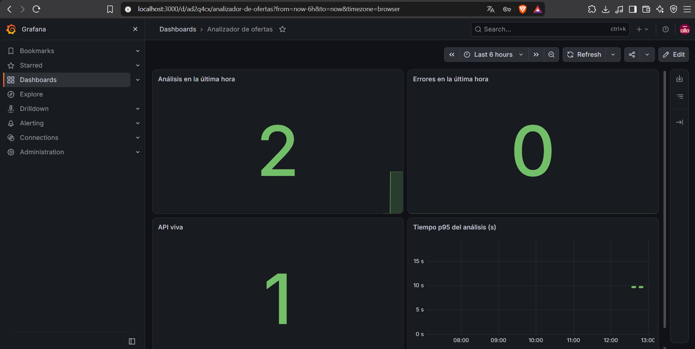
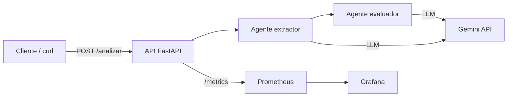

# Analizador de ofertas de empleo con agentes de IA

Sistema de dos agentes de IA (CrewAI + Gemini) que analiza una oferta de empleo,
la compara con un perfil y entrega un informe con fortalezas, vacíos y pasos
para cerrarlos. Se sirve como API (FastAPI), corre en contenedores Docker y se
monitorea con Prometheus y Grafana.

> Proyecto de aprendizaje de DevOps y programación agéntica.



## Arquitectura



1. El **agente extractor** identifica cargo, requisitos obligatorios y deseables.
2. El **agente evaluador** recibe ese resultado, lo compara con el perfil y genera el informe.
3. La API expone métricas propias que Prometheus recoge cada 15 s y Grafana grafica.

## Tecnologías

Python · CrewAI · Gemini API · FastAPI · Pydantic · Docker · Docker Compose · Prometheus · Grafana · WSL2 (Ubuntu)

## Cómo ejecutarlo

Requisitos: Docker y una clave gratuita de Gemini (Google AI Studio).

```bash
git clone https://github.com/DiegoCuadross/devops-agentes.git
cd devops-agentes
cp .env.example agente/.env   # y pon tu clave en agente/.env
docker compose up -d --build
```

| Servicio | URL |
|---|---|
| API (documentación interactiva) | http://localhost:8000/docs |
| Prometheus | http://localhost:9090 |
| Grafana | http://localhost:3000 |

Ejemplo de uso:

```bash
curl -X POST http://localhost:8000/analizar \
  -H "Content-Type: application/json" \
  -d '{"oferta": "Texto de la oferta...", "perfil": "Tus habilidades..."}'
```

## Endpoints

| Método | Ruta | Descripción |
|---|---|---|
| POST | `/analizar` | Recibe oferta y perfil, devuelve el informe |
| GET | `/health` | Estado del servicio |
| GET | `/metrics` | Métricas en formato Prometheus |

## Observabilidad

| Métrica | Tipo | Qué mide |
|---|---|---|
| `analisis_total{resultado}` | Counter | Análisis exitosos y fallidos |
| `analisis_duracion_segundos` | Histogram | Duración de cada análisis (se grafica el p95) |
| `up` | Gauge (Prometheus) | Si la API responde |

## Decisiones de diseño

- **Configuración fuera del código:** la clave y el modelo llegan por variables de entorno; nunca se incluyen en la imagen (`.dockerignore`) ni en el repositorio (`.gitignore`).
- **Validación de entrada:** Pydantic limita el tamaño de la oferta y el perfil para proteger la cuota del modelo.
- **Manejo de errores:** si el modelo no está disponible (p. ej. 503 por saturación), la API responde un 503 claro y registra el error.
- **Logs sin datos personales:** se registra el tamaño de la solicitud, no su contenido.

## Limitaciones

- Los modelos de lenguaje no son deterministas: el porcentaje de coincidencia es una estimación y puede variar entre ejecuciones.
- Usa el nivel gratuito de Gemini, con límites de uso.

## Próximos pasos

- [ ] Métrica de tokens consumidos por análisis
- [ ] Tablero de Grafana cargado automáticamente (provisioning)
- [ ] Despliegue en Google Cloud Run con Terraform
- [ ] CI/CD con GitHub Actions
- [ ] Migración del flujo a LangGraph
